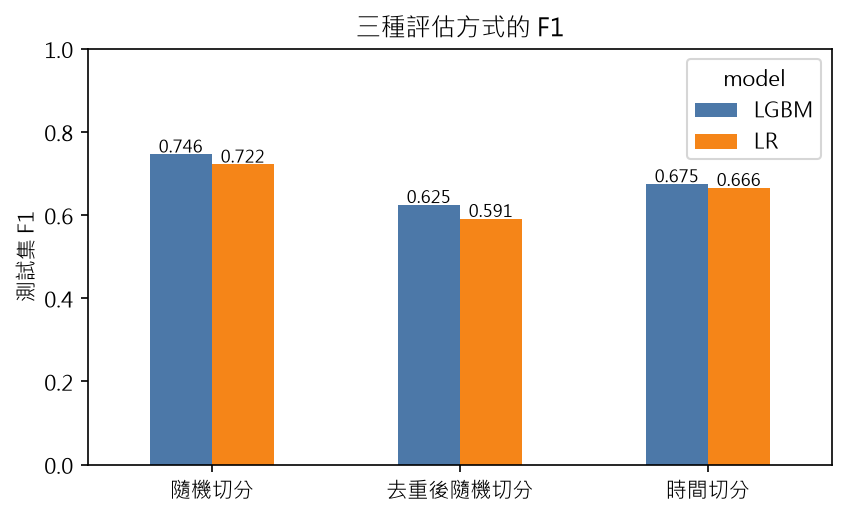
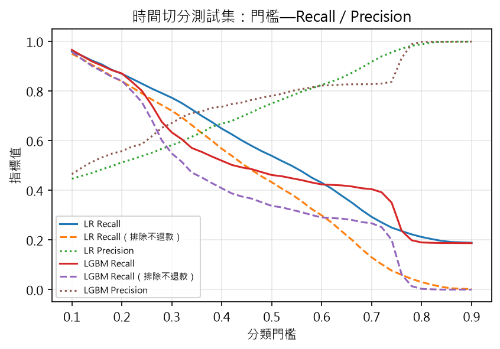

# 訂房取消預測評估報告

- 資料：`data/hotel_bookings.csv`；119,209 筆（已刪除 181 筆人數為 0 或房價為負）；期間 2015-07-01 ~ 2017-08-31；取消率 37.1%
- 模型：Logistic Regression（C=0.1）、LightGBM（15 葉、100 棵）；種子 42
- 使用特徵（27 欄）：hotel, lead_time, arrival_date_week_number, arrival_date_day_of_month, stays_in_weekend_nights, stays_in_week_nights, adults, children, babies, meal, market_segment, distribution_channel, is_repeated_guest, previous_cancellations, previous_bookings_not_canceled, reserved_room_type, booking_changes, deposit_type, agent, company, days_in_waiting_list, customer_type, adr, total_of_special_requests, total_guests, total_nights, arrival_month

## 一、洩漏檢查

| 欄位                        | 判定                 | 第一層         | 第一層說明                                       | 第二層理由                                                                                                            |   單欄 AUC |   使用此欄的 F1 增量 | 算法                   |
|:----------------------------|:---------------------|:---------------|:-------------------------------------------------|:----------------------------------------------------------------------------------------------------------------------|-----------:|---------------------:|:-----------------------|
| booking_changes             | 保留但檢查（第一層） | 可能含事後資訊 | 統計到入住或取消為止；預設保留，請看加回／刪除差 |                                                                                                                       |     0.5704 |               0.0025 | 刪除後的 F1 差（取負） |
| reservation_status          | 排除（第一層）       | 事後資訊       | 訂單最後狀態，Canceled／No-Show 直接對應答案     | Canceled 取消率 100.0%（n=30,086）；Check-Out 取消率 0.0%（n=52,507）；No-Show 取消率 100.0%（n=853）；單欄 AUC 1.000 |     1      |               0.254  | 加回後的 F1 差         |
| country                     | 排除（第一層）       | 入住時才確定   | 訂房時多預設為葡萄牙，入住出示證件才更正         |                                                                                                                       |     0.701  |               0.0411 | 加回後的 F1 差         |
| required_car_parking_spaces | 排除（第一層）       | 入住時才確定   | 停車需求多在抵達時登記                           | 1 取消率 0.0%（n=5,164）                                                                                              |     0.5506 |               0.0128 | 加回後的 F1 差         |
| arrival_date_year           | 排除（第一層）       | 不可外推       | 年份只有少數值，無法外推到未來                   |                                                                                                                       |     0.5118 |               0.0101 | 加回後的 F1 差         |
| assigned_room_type          | 排除（第一層）       | 入住時才確定   | 實際分配房型，可能因超賣或客人要求改變           |                                                                                                                       |     0.6047 |               0.007  | 加回後的 F1 差         |
| reservation_status_date     | 排除（第一層）       | 事後資訊       | 最後狀態的日期                                   | 2015-01-01 取消率 100.0%（n=541）                                                                                     |     0.7615 |             nan      | 日期字串欄位，未測     |
| deposit_type                | 需人工確認（第二層） |                |                                                  | Non Refund 取消率 99.4%（n=10,195）                                                                                   |     0.6631 |               0.0128 | 刪除後的 F1 差（取負） |

## 二、三種評估方式

| 評估方式       | 模型   |   訓練筆數 |   測試筆數 |   門檻（驗證集選） |    f1 |   precision |   recall |   auc |
|:---------------|:-------|-----------:|-----------:|-------------------:|------:|------------:|---------:|------:|
| 隨機切分       | LR     |      83446 |      17882 |               0.42 | 0.722 |       0.762 |    0.685 | 0.857 |
| 隨機切分       | LGBM   |      83446 |      17882 |               0.34 | 0.746 |       0.737 |    0.756 | 0.884 |
| 去重後隨機切分 | LR     |      61060 |      13085 |               0.34 | 0.591 |       0.551 |    0.638 | 0.791 |
| 去重後隨機切分 | LGBM   |      61060 |      13085 |               0.3  | 0.625 |       0.564 |    0.699 | 0.828 |
| 時間切分       | LR     |      83320 |      17898 |               0.32 | 0.666 |       0.597 |    0.751 | 0.795 |
| 時間切分       | LGBM   |      83320 |      17898 |               0.26 | 0.675 |       0.618 |    0.743 | 0.81  |

F1 落差：

| model   |   去重後隨機切分 |   時間切分 |   隨機切分 |   隨機−時間 |   隨機−去重 |
|:--------|-----------------:|-----------:|-----------:|------------:|------------:|
| LGBM    |            0.625 |      0.675 |      0.746 |       0.071 |       0.121 |
| LR      |            0.591 |      0.666 |      0.722 |       0.056 |       0.131 |

## 三、實務指標（時間切分測試集）

| 模型   |   門檻 |   排除不退款 Recall |   每日前 10% Precision |   前 10% 涵蓋的取消比例 |   基準取消率 |
|:-------|-------:|--------------------:|-----------------------:|------------------------:|-------------:|
| LR     |   0.32 |               0.694 |                  0.862 |                   0.226 |        0.395 |
| LGBM   |   0.26 |               0.683 |                  0.846 |                   0.222 |        0.395 |

## 註

- 第二層統計規則只是提示，不代表欄位一定洩漏；本研究的 country 不會被統計規則標出，而保留的 deposit_type 會被標出。
- 「使用此欄的 F1 增量」在隨機切分下計算，數值大不代表欄位可用，事後資訊會讓隨機切分的效能偏高。
- 門檻一律在驗證集上選擇（最大化 F1），測試集只評估一次。
- 時間切分依抵達日排序取前 70%／15%／15%；效能落差（隨機−時間）愈大，表示隨機切分愈高估模型對未來的表現。
- 去重只刪除所有欄位完全相同的列；資料沒有訂單編號，無法分辨團體訂單與重複登錄。

執行時間 34 秒